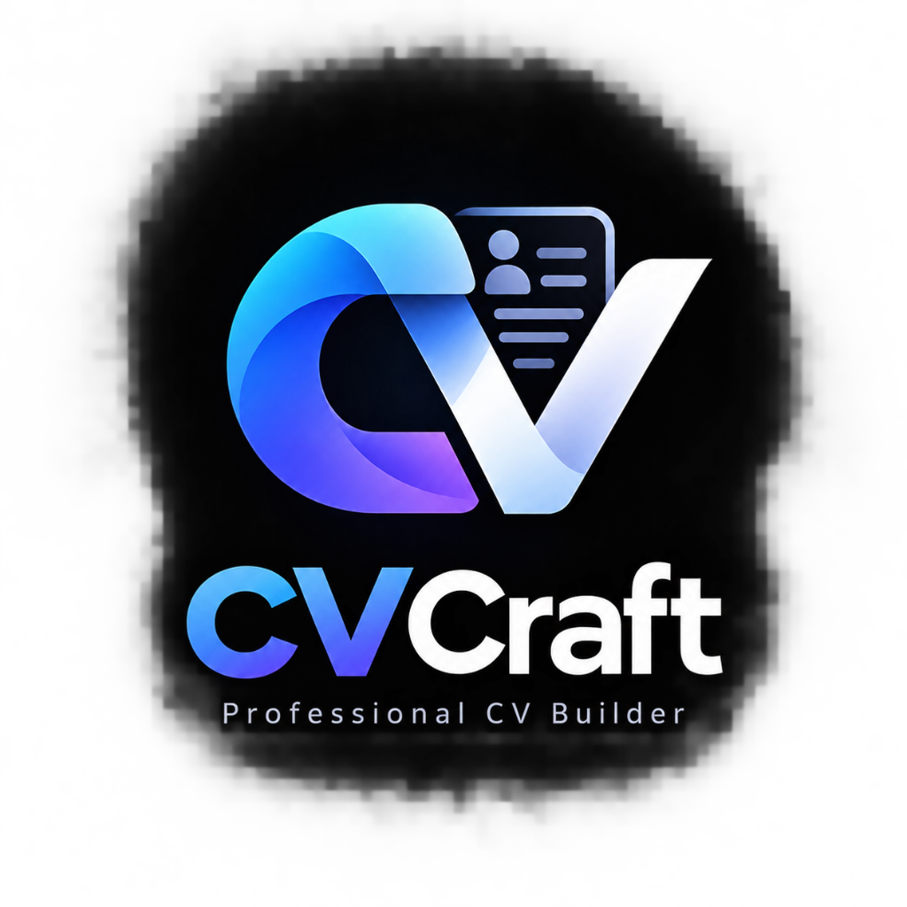

# <p align="center"><br>CVCraft — Professional ATS-Friendly CV Builder</p>

<p align="center">
  <b>A lightweight, high-performance, frontend-only web application built to craft ATS-optimized, high-impact Software Engineering resumes.</b>
</p>

---

## 🚀 Features

- **ATS-Optimized Formatting**: Pixel-perfect ATS standard structure, typography, and density tailored for top-tier Applicant Tracking Systems.
- **Dynamic Live Scoring**: Real-time ATS match analyzer rating content, keyword density, section taxonomy, and quantified bullet points.
- **Interactive Multi-Stack Taxonomies**: Effortlessly organize programming languages, backend systems, databases, Web3/blockchain, and DevOps.
- **Full Link Visibility & Clean Demarcation**: Independent toggles for GitHub, Live Demo, and Credential links with clean PDF printing (zero ugly underlines or link boxes).
- **Responsive Architecture**: Fully mobile-friendly with seamless Editor / Live Preview tab switching and adaptive auto-scaling.
- **Zero Backend Required**: Runs entirely in the browser using HTML5, Vanilla CSS3, and Modern JavaScript (ES Modules).

---

## 🛠️ Quick Start

```bash
# 1. Install dependencies
npm install

# 2. Start the interactive development server
npm run dev

# 3. Build for production
npm run build
```

---

## 📄 Pre-loaded Profile

Synchronized directly for **Md. Shahidur Rahman (KUET CSE)**:
- **Portfolio**: [shahidur.dev](https://shahidur.dev)
- **GitHub**: [github.com/shahidur8381](https://github.com/shahidur8381)
- **LinkedIn**: [linkedin.com/in/shahidur8381](https://www.linkedin.com/in/shahidur8381)
